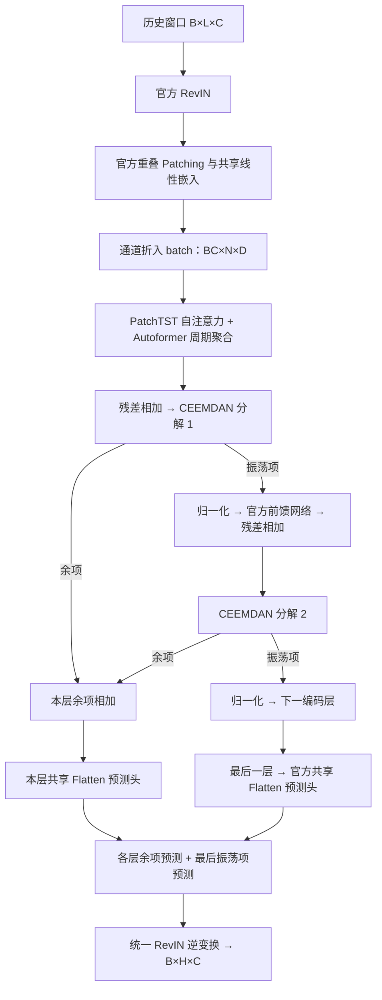

# CEEMDAN × Autoformer × PatchTST：逐层分解骨干

本版按新的结构要求实现：**将 CEEMDAN 分解直接放进每个编码层**，结合 Autoformer 的周期聚合与逐层余项累积；保留官方 PatchTST 的 Patching、Channel-independence、RevIN、Flatten Head 和监督训练机制。不是之前 V2 的输入条件适配器，也没有完整模型输出之间的集成。

## 结构



一个编码层执行两次真实 CEEMDAN，沿 **patch 时间轴 N** 分解每个隐特征，既不沿变量轴分解，也不把隐状态结果预先缓存。每层提取的余项分别投影到未来 H 步，再相加；振荡项送入下一层。余项在预测空间累积借鉴 Autoformer decoder 的设计，本版仍是 PatchTST 的直接多步预测，不引入 decoder 或 teacher forcing。

## 快速运行

```bash
python3.11 -m venv .venv
source .venv/bin/activate
pip install -r requirements.txt
python -m pytest -q
bash scripts/smoke_etth1.sh
```

当前目录已配置 `.venv`，可直接 `source .venv/bin/activate`。`requirements.lock.txt` 记录本次独立环境实际安装版本；需要复现该环境时用它替代宽范围的 `requirements.txt`。

`data/ETTh1.csv` 为之前项目已有数据的副本，保留来源和许可。smoke 脚本用真实 ETTh1 的 OT 变量，96→24、两层、真实 CEEMDAN，只跑少量 batch，用于检查前向、反向、验证选择、权重保存/重载及测试预测。**smoke 指标不能用于判断模型优劣。**

完整多变量训练：

```bash
bash scripts/train_etth1.sh
```

完整训练计算量很大，请先看 [方法、梯度和计算成本](docs/ARCHITECTURE.zh.md)。脚本默认小骨干用于实际起跑，并非论文 PatchTST 的最佳超参数。

## 对比和消融

所有模型使用相同的数据划分、历史长度、预测长度、训练预算和种子：

```bash
# 官方 PatchTST 基线，官方模型源文件未改动
MODEL=PatchTST bash scripts/train_etth1.sh
# 完整融合
bash scripts/train_etth1.sh
# 将 CEEMDAN 换回可微的移动平均，其余融合结构相同
bash scripts/train_etth1.sh --progressive_decomp moving_avg
# 移除逐层分解
bash scripts/train_etth1.sh --progressive_decomp none
# 保留逐层 CEEMDAN，仅使用 PatchTST 注意力
bash scripts/train_etth1.sh --fusion_attention self
# 仅使用周期聚合
bash scripts/train_etth1.sh --fusion_attention autocorrelation
```

`none` 消融仍构造余项头，但其输入为零，不参与有效预测；因此“总参数量相同”不代表有效容量相同。官方 Autoformer 也保留在 `models/Autoformer.py`，可通过 `run_longExp.py --model Autoformer` 运行；需要按其 decoder 参数单独配置，不能用 smoke 结果得出优劣结论。

## 训练与结果

直接扩展官方 `run_longExp.py` / `exp/exp_main.py`，沿用 Adam、最终预测 MSE、`--lradj TST` 对应的 OneCycle 学习率、验证集早停及最优权重重载。监督信号是原目标序列；不会 CEEMDAN 分解未来标签，也不额外施加 IMF 辅助损失。

检查点目录保存 `config.json`、`history.json`、`checkpoint.pth`。结果目录保存 `pred.npy`、`true.npy`、`metrics.json`，其中记录是否限制了运行步数。融合配置纳入实验名称。推理可用相同配置和 `--is_training 0` 重载权重；模型接口仍为 `model(x)`，输入 `[B,L,C]`，输出 `[B,H,C]`。检查点是权重，必须配合同目录配置恢复同一结构。

新增训练进程默认每 100 批保存 `latest_training.pth`，整轮训练后、完整验证前也保存一次；其中包含模型、优化器和学习率调度器状态，不覆盖最佳验证权重。可通过 `--checkpoint_interval` 调整，或在该次检查点目录创建空文件 `checkpoint.request` 请求下一个批次边界保存。**源文件更新不会改变已经运行中的旧训练进程。**快照尚未提供恢复到完全相同数据迭代位置的入口。

快速筛查可运行 `quick_validate.py --config <完整训练的config.json> --output <新结果目录>`：默认相同结构分别训练融合模型和 PatchTST 各 64 批，固定抽样窗口，使用缩短周期的 OneCycle 调度，比较验证区间均匀抽取的 32 个窗口与延续预测。每 8 批保存快照，第 16 批给出 16 窗口初评。它是独立短试验，不能视为已有长训练的中途权重或稳定效果结论。

完整首轮比较可用 `compare_first_epoch.py --fusion-checkpoint-dir <首轮检查点目录> --output <新比较目录>`。脚本冻结现有融合首轮权重，两个原模型各补训一轮，保留原 30 轮学习率日程并评估完整验证集。Autoformer 官方层有两处写死 CUDA 的索引分配，已改为跟随输入设备；修改不影响自相关数学计算，详见 `UPSTREAM.json`。CPU 推理回归检查已补充。

训练标签去噪对照可运行 `label_denoise_experiment.py --output <新结果目录>`，默认配置为 `configs/label_denoise_pilot.json`：使用原始历史输入，分别用原始标签、删除 IMF1 的标签、删除 IMF1+IMF2 的标签训练官方 PatchTST。CEEMDAN 仅在训练时段离线执行一次；验证选模与测试评价都使用原始目标。默认 1,024 个训练窗口、512 个验证窗口、完整测试窗口、三个配对种子，30 轮上限、5 轮早停，运行前测量计算预算。所有条件与种子的选模结束后才读取测试标签做评价。可用 `analyze_label_denoise.py --experiment <结果目录>` 核对标签来源、预测和权重，并生成对比图与配对时间区块自举区间。高频 IMF 是疑似噪声候选，不能直接认定为纯噪声。

用新去噪标签作为评价对照时，运行 `reevaluate_denoised_targets.py --experiment <原试验目录> --output <新评价目录>`。它复用固定预测，将测试段离线重构为两个新的共同参考，输出原始/去噪参考 × 三种训练标签的交叉比较。MAPE、WMAPE 均在原始单位计算，记录近零排除与逐变量/总体合并两种聚合；该评价不会重训、重选模型或覆盖原始目标上的结果。

删除两个 IMF 后匹配均值可运行 `mean_matched_label_experiment.py --source <标签去噪原试验目录> --output <新结果目录>`。各变量系数为“原始训练段均值 / 去噪训练段均值”，四舍五入保留四位小数；在原始单位下乘标签，再标准化并按原起点采样。只新增三个配对种子模型，系数仅由训练段拟合，测试时固定沿用。报告同时按原始目标、未校准去噪目标、使用训练系数校准的去噪目标比较，并输出 MAPE、WMAPE。整段训练均值匹配不代表抽样窗口或分布不同的测试段也严格匹配。

官方 `decomposition` 开关对照可运行 `official_decomposition_label_experiment.py --source <标签去噪原试验目录> --output <新结果目录>`。取消均值对齐，分别使用删除 IMF1、删除 IMF1+IMF2 的固定标签，开启官方 25 点移动平均输入分解及两个独立 PatchTST 分支；关闭对照复用既有三种子预测并重算核对。保持原始验证标签选模策略，最终在对应去噪测试标签上比较。该官方开关同时增加参数量，报告记录两种状态的参数数目与配对不确定性。

## TimeXer 与 Traffic

已接入 [TimeXer 官方结构](https://github.com/thuml/TimeXer)：内生变量采用非重叠 patch，外生变量每个历史序列对应一个 token，全局 token 通过交叉注意力融合外生信息。保留官方逐窗口标准化和预测反标准化，支持 `M`、`MS`、`S`，兼容现有训练、验证、测试和预测入口。

Traffic 文件位于 `data/traffic/traffic.csv`，包含 17,544 小时、862 个传感器的道路占用率。按时间划分 70% 训练、10% 验证、20% 测试，标准化器只拟合训练段，验证和测试保留输入历史上下文。`--data traffic` 自动选择文件路径和 862 通道；单变量 `S` 模式使用 1 通道。也可通过 `--data custom` 显式指定该文件。

```bash
# 文件缺失时下载；已存在则核验 SHA-256，不重复下载
.venv/bin/python scripts/download_traffic.py

# 真实 Traffic 上验证训练、选模、重载、测试、未来预测（只执行少量批次）
bash scripts/smoke_traffic_timexer.sh

# MS：最后一个传感器 OT 为预测目标，其余 861 个为历史外生变量
bash scripts/train_traffic_timexer.sh

# M：预测全部 862 个传感器；可替换预测长度为 96、192、336、720
FEATURES=M PRED_LEN=192 bash scripts/train_traffic_timexer.sh
```

脚本提供可运行的训练起点，不代表论文各任务的最优超参数。可在命令末尾覆盖参数，例如 `--batch_size 4 --train_epochs 20`；其他环境可设置 `PYTHON=python`。`MS` 的目标列会被加载器移到最后；不要把 862 通道输入误设成 `enc_in=1`。`--use_norm 0` 关闭 TimeXer 窗口标准化；`stride`、`revin` 等 PatchTST 专用选项不影响 TimeXer。输入长度不能小于 patch 长度；长度不能整除时，遵循官方代码丢弃末尾不足一个 patch 的时间点，但外生序列嵌入仍使用完整窗口。模型只读取历史值和历史时间特征，忽略解码器输入与未来时间特征。`S` 模式需提供历史时间特征作为交叉注意力上下文。官方实现关闭注意力图输出，本地 `--output_attention` 返回 `(预测, None)` 以兼容训练入口。

下载脚本使用固定版本的公开 LTSF 数据镜像，仅提取 Traffic，并保存来源及校验值到 `data/traffic/SOURCE.json`。作者提供的原始数据集合链接和镜像区别见该文件；校验值固定本次数据副本，并非作者发布的校验值。数据文件约 136 MB，已从版本控制中排除。完整多变量评估会保存所有预测，长预测窗口需预留足够内存。

### 采样目标的 MS 对比

`compare_traffic_sampled_ms.py` 将文件中的零基索引 `0, 10, ..., 860` 共 87 个传感器设为目标，其余 775 个设为外生上下文。两个模型各训练一个直接输出 10 步的模型，再对同一最佳权重评估前 1、2、5、10 步平均误差，并额外报告第 1、2、5、10 步本身的误差。

```bash
.venv/bin/python -u compare_traffic_sampled_ms.py \
  --output results/traffic_sampled_ms_run \
  --train-seconds 3600 --validation-interval 200 --patience 15
```

每个模型的计时只累计训练批次，完整验证、保存和加载时间另计；连续 15 次完整验证的 10 步 MSE 未创新低时早停。输入长度 96、批大小 8、宽度 32、2 层、4 个头、FFN 64、Adam 学习率 0.0003、种子 2021。两者只使用传感器历史值，不输入时间标记或未来协变量。训练、选模、测试和报告自动顺序执行，状态及错误写入结果目录的 `status.json`。

原版 TimeXer MS 只预测最后一个通道。本次通过可选的 `target_indices` 扩展为多个目标的独立 patch/global token，共用外生变量及编码器/预测头；所选目标全部排除在外生 token 集合之外。默认 MS 单目标行为保持兼容。PatchTST 模型结构不变，输入全部通道，仅所选目标参与损失；训练时默认 BatchNorm 仍存在通道间统计耦合。

## 文件

- `models/CEEMDANPatchTST.py`：单一融合模型、分块和预测重构。
- `layers/CEEMDAN_PatchTST_backbone.py`：逐层分解和周期聚合。
- `layers/CEEMDAN_decomp.py`：真实 CEEMDAN、固定种子、明确的梯度约定。
- `tests/test_progressive.py`：分解正确性、结构调用、梯度、独立性和重载验证。
- `UPSTREAM.json`：官方代码版本与修改文件；保留 Apache-2.0 许可。

参考：[官方 PatchTST](https://github.com/yuqinie98/PatchTST)、[官方 Autoformer](https://github.com/thuml/Autoformer)、[PyEMD CEEMDAN](https://pyemd.readthedocs.io/en/latest/ceemdan.html)。当前完成的是结构实现与运行验证，26 项检查通过；详见 [验证记录](docs/VERIFICATION.zh.md)。尚无完整训练证明它超过两个原模型。
